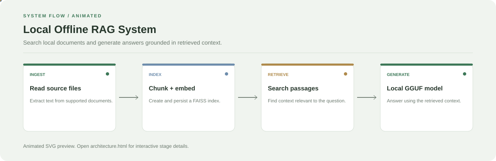

# Local Offline RAG System

**Search local documents and generate answers grounded in retrieved context.**

[](https://github.com/chyk2468/RAG-File-Search)

## 1. Project Title & Tagline

Search local documents and generate answers grounded in retrieved context.

## 2. Problem Statement

Users need to find answers across their own documents without manually opening each file. A local RAG pipeline retrieves relevant passages and passes them to a local language model.

## 3. Project Preview

Add a screenshot or short GIF showing document ingestion, retrieved passages, and the generated answer.

[Open interactive architecture](architecture.html)

## 4. Overview

The pipeline indexes document text, retrieves relevant passages for each query, and returns context-grounded results.

## 5. Key Features

- Ingest supported local documents.
- Chunk text and build a local FAISS index.
- Retrieve relevant passages for a question.
- Generate an answer using a local GGUF-compatible model.

## 6. Architecture / Workflow



Open the [interactive architecture explorer](architecture.html) to select a stage and inspect its role.


## 7. Tech Stack

Python, Streamlit, FAISS, local embeddings, GGUF-compatible language model

## 8. Installation & Setup

```bash
git clone https://github.com/chyk2468/RAG-File-Search.git
cd RAG-File-Search
python -m venv .venv
pip install -r requirements.txt
```

## 9. Usage

Run `streamlit run app.py`, ingest the selected documents, and ask a question about their contents. Configure the local model path expected by the generation module and check the retrieved passages to validate each answer.

## 10. Project Structure

- `app.py`: Streamlit interface
- `ingestion.py`: document loading
- `chunking.py`: chunk creation
- `storage.py`: FAISS index persistence
- `retrieval.py`: relevant-context search
- `generation.py`: answer generation

## 11. Results & Demo

Add an example document, query, retrieved excerpts, and generated answer. Record retrieval settings and response time, and validate answers against their source passages.

## 12. Future Enhancements

- Add source citations in answers.
- Support incremental indexing and deletion.
- Add tests for retrieval relevance.
- Expose chunking and model settings in the UI.

## 13. License

Check the source code, embedding model, and language model licences before redistribution.
