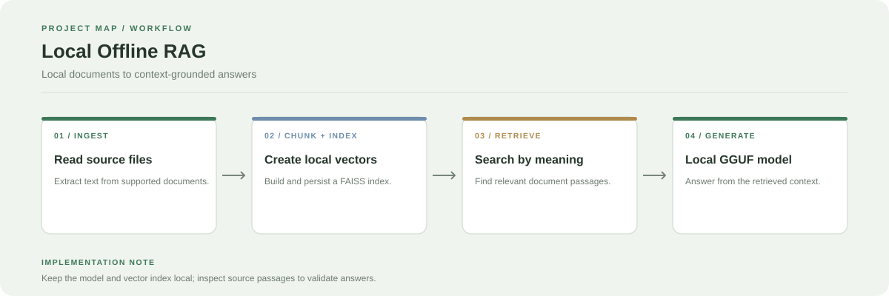

# Local Offline RAG System

A local document question-answering app that combines document ingestion, chunking, FAISS vector retrieval, and a GGUF-compatible language model.

**Stack:** Python, Streamlit, FAISS, local embeddings, GGUF-compatible LLM



## How it works

1. Ingest supported documents from the configured local directory.
2. Split extracted text into chunks with overlap.
3. Create and persist a FAISS vector index.
4. Retrieve relevant chunks for a user's question.
5. Pass the retrieved context to the local language model and return an answer.

## Main modules

- `app.py`: Streamlit interface and pipeline controls
- `ingestion.py`: document loading
- `chunking.py`: chunk creation
- `storage.py`: FAISS index persistence
- `retrieval.py`: relevant-context search
- `generation.py`: answer generation

## Run locally

```bash
git clone https://github.com/chyk2468/RAG-File-Search.git
cd RAG-File-Search
python -m venv .venv
```

Activate the environment and install the project's dependencies:

```bash
pip install -r requirements.txt
streamlit run app.py
```

Use the sidebar to build the index or load an existing index. Place the selected GGUF model where `generation.py` expects it and review the model configuration before running inference.

## Privacy and limitations

Documents and indices can remain on the local machine, but verify the exact model and embedding configuration used by your checkout. Local generation can still return unsupported statements, so validate answers against the retrieved passages.
